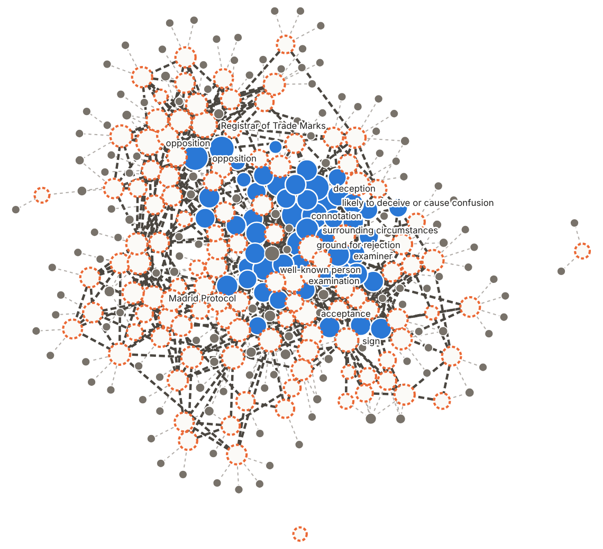
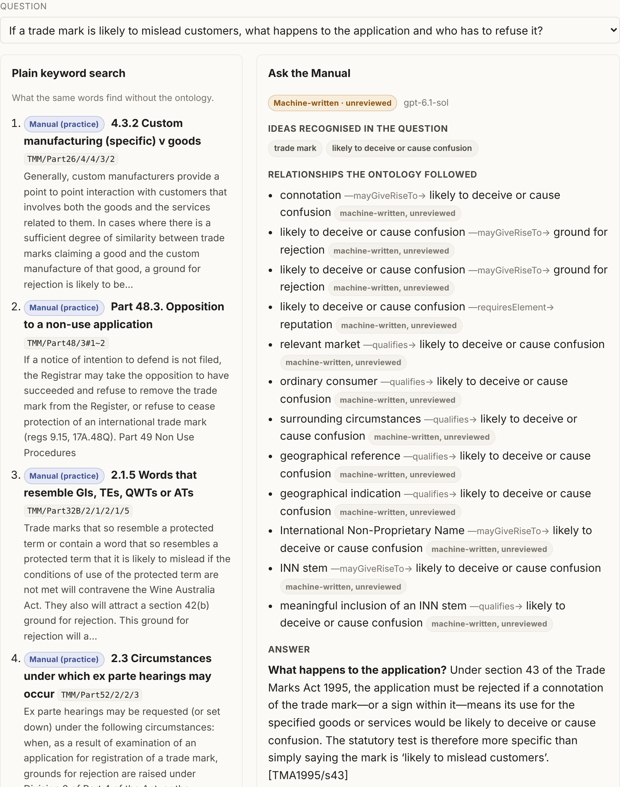

# Pitch pack — what an ontology adds to the Trade Marks Manual (D4)

**Status: draft for the owner, rewritten 2026-10-17 (S038) to the claims the owner chose**
(OQ-0029, ADR-0136): *"Claim the gain over keyword search, and say plainly that modern
search ranks better. Then lead with what the ontology uniquely does."* The two claims are
below, then the lead. Everything else here reports; it does not claim.

The draft slide deck is a private artifact, <https://claude.ai/artifact/A8w4WZ99aFkm1w4MyfQrFA>.
S038 could not open it (the artifact service said it was not found for this account), so it
still carries the 7 October draft. This file is its source of truth until it is rebuilt.

Everything machine-written is unreviewed: no trade marks expert has read any of it.

## The claim

1. **Against keyword search, the ontology-assisted search ranks better passages.** Over 129
   questions, top-ten quality (nDCG@10) is higher by **+0.079 [+0.042, +0.116]**, and for
   questions asked in everyday words by **+0.151 [+0.081, +0.228]**.
2. **Modern search that also matches by meaning ranks better still.** The ontology-assisted
   search is **−0.041 [−0.067, −0.017]** below it: a small margin, and a real one.

Both from `data/derived/reports/measure.md`, scored at commit `a255063dbe1b` on rankings
taken 2026-10-09; 95% paired bootstrap intervals. **Not re-measured since**: the
relationships re-read and restructured after 9 October, the definitions, the move to the
Act's compilation 48 and the fix for common concepts flooding results (still open) all
postdate it, and the owner deferred re-measurement (CHAT-0084).

## What only the ontology does

Shown on the examiners' site, not measured. This is the lead.

1. **It shows its working.** For any question: the ideas it recognised (including everyday
   words, "a smell" for a scent trade mark), the connections it followed, each with its
   modality and the condition it holds under, the passages it gathered, and an answer whose
   every quote code has found word for word in the passage. Search gives a list; this gives a
   reason for the list.
2. **It keeps the law and the practice apart at every point.** Every passage says whether it
   is the Act, the Regulations or the Manual; an answer sentence that says "the Act requires"
   with no provision cited is flagged (PU-0004); a definition says whose words it is.
3. **It says what a term means, in the law's own words first.** 149 of 164 concepts carry a
   definition: 53 are the Act's or Regulations' own definitions, quoted; 22 are written from a
   provision; 74 from the Manual. Where "application" means different things, a scope note
   says which.
4. **It traces every statement to a sentence and a stamp.** Each machine-written record names
   who wrote it and when, quotes the passage it rests on with an exact span and hash, and says
   "unreviewed". The 190 records an expert signed stay apart, unedited, as the yardstick.
5. **It answers "what would this change touch?"** A rewrite of any Manual page, or an
   amendment to a section, reaches the passages, concepts and connections that rest on it.
6. **It knows what it may not say.** It never states how an application will be decided:
   16 of the 129 prepared answers declined that part of their question. It is told never to
   conclude that a requirement, exception or step does not exist because its sources do not
   mention one, and every answer says its sources may not be complete.

*Screenshot taken 2026-10-07; the map has since been restructured (see the site).*

## What was built (D1)

Counted at this pin (upstream `308bfd9`) by `tmk-graph` and
`data/derived/reports/ontology.md`, regenerated in S038.

| | Signed by an expert | Written by a machine, unreviewed |
|---|---|---|
| Concepts | 52 | 112 |
| Concepts sorted into a kind | 0 | 164 |
| Concepts with a definition | 0 | 149 |
| Relationships between concepts | 35 (20 serving, 15 corrected) | 337 |
| Corrections to signed records | — | 37 |

- **All 164 concepts sit in one connected piece.**
- 7,128 links from concepts to passages; 1,649 of the Manual's 2,460 passages name at least
  one concept (`data/derived/links/mentions.json`).
- The graph passes its shape checks (SHACL) with 0 defects. Every machine-written record
  carries its author, the date, the passage it rests on with an exact span and hash, and
  `review_status: unreviewed`.
- The law held: **the Act as in force from 19 September 2026** (compilation 48,
  `C2026C00421`) and the Regulations as in force from 18 December 2025. Every answer names
  the compilation it read.

## Ask the Manual (D2)

A prepared answer for every one of the 129 benchmark questions, beside plain keyword search,
and live answers to an examiner's own question through a proxy that holds the key.

- Every prepared answer carries at least one citation located verbatim by code; 4.7 on
  average. 86 of 129 cite the Act or Regulations as well as the Manual. 16 declined the part
  of a question that asked how an application would be decided
  (`data/derived/bench/answers.yaml`, written 2026-10-09, prompt `answer-v2`; read against
  the Act as in force from 14 October 2024).
- Live answers (prompt `answer-v3`, since S038) also see each connection's modality and
  condition, and the rule against concluding absence.

*Screenshot taken 2026-10-07.*

## The measurement (D3)

Three systems, fixed before any grading: **keyword** (word matching, like a search box),
**hybrid** (keyword plus meaning vectors: good modern search, no ontology) and **ontology**
(hybrid plus recognised concepts, their wording and their linked passages). 119 questions
written by a model in four kinds, plus the expert's 10 signed questions; every pooled
passage graded 0–3 by `gpt-6.1-sol`. nDCG@10 with paired bootstrap 95% intervals.

From `data/derived/reports/measure.md`, scored at commit `a255063dbe1b` (2,344 grades,
rankings taken 2026-10-09):

| Questions | n | Keyword | Hybrid | Ontology | Ontology − keyword | Ontology − hybrid |
|---|---|---|---|---|---|---|
| All | 129 | 0.725 | 0.844 | 0.803 | **+0.079 [+0.042, +0.116]** | **−0.041 [−0.067, −0.017]** |
| Everyday problem | 29 | 0.677 | 0.848 | 0.827 | **+0.151 [+0.081, +0.228]** | −0.021 [−0.055, +0.010] |
| Lookup | 30 | 0.773 | 0.894 | 0.820 | +0.046 [−0.015, +0.110] | −0.075 [−0.129, −0.025] |
| Cross-Part | 30 | 0.728 | 0.832 | 0.778 | +0.050 [−0.015, +0.125] | −0.054 [−0.116, −0.000] |
| Impact | 30 | 0.732 | 0.837 | 0.802 | +0.070 [−0.023, +0.171] | −0.036 [−0.099, +0.017] |
| The expert's 10 | 10 | 0.686 | 0.735 | 0.766 | +0.080 [−0.024, +0.177] | +0.030 [+0.008, +0.055] |

Bold rows are the two claims. The expert's ten favour the ontology over hybrid search,
modestly; ten questions are too few to claim it, and the owner did not.

**The reading** (`data/derived/reports/measure-reading.md`, commit `d248c18271ed`, rankings
2026-10-12): in the browser's own search, with no meaning vectors, starting from ideas a
model read in the question recovers what starting from names alone loses: reading − names
+0.040 [+0.009, +0.070]; names − keyword −0.041 [−0.067, −0.014]; reading − keyword −0.001
[−0.039, +0.036].

**Why it trails hybrid search, diagnosed afterwards:** concepts named everywhere ("trade
mark", "applicant", "Registrar") pull loosely related passages into the top ten. The fix is
designed and not yet made or measured.

## The honest limits

- **No expert has read the machine's work**: 112 concepts, 164 typings, 149 definitions, 337
  relationships, 37 corrections, 129 answers. Examiners review it all at once when it ships.
- **Models wrote and graded the test.** The only human yardstick is the expert's 10
  questions, too few to establish a difference.
- **The numbers are from 9 and 12 October** and predate the work since; re-measurement is
  deferred.
- **One snapshot**: the Manual as captured, the Act as in force from 19 September 2026. No
  update loop yet; a re-pin re-reads what moved, by hand.
- **It names procedural steps and some orderings; it is not a process model.**
- **No judgment text is held**, so cases can be cited and never read.
- **Its web addresses are names, not addresses**: nothing is published at them yet.
- **It explains; it does not decide.** It never applies the law to an application's facts.
- **As measured, modern search ranks better than it.**

## What it cost

**US$9.63** recorded across every model call (`tmk-bulk spend`), against a cap of US$9.49
(the US$6.60 quote plus US$2.89 for the audit). The reading's US$1.13, of the US$1.60 the
owner approved for it, and an unasked US$0.12 smoke test took it over the cap, so every paid
call is now refused until the owner names an amount. Rounded: answers $2.64 · second-model audit of relationships $3.12 · relationships $1.23 ·
grading $0.98 · the reading measured $0.81 · test questions $0.34 · concepts $0.18 ·
everyday phrasings $0.12 · live demonstration calls $0.15 · other $0.07. The definitions,
corrections and restructuring were written by agent sessions with no model call. The ledger
is the committed response cache, `data/llm/cache/`.

## What would come next

1. **Examiners review the machine's work**, all at once, at ship time: for a first measured
   error rate, start with a sample of relationships, definitions and answers.
2. **Fix the flooding by common concepts**, then re-measure with the change declared first,
   when the owner names an amount.
3. **A pilot with examiners** on real questions, stamp in place, with an update loop.
